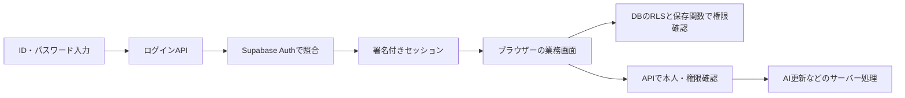

# 認証・権限移行（2026-10-30）

## requirements

ユーザーより、本人確認をSupabase Auth、業務データの制限をDBのRLS、管理権限を使うAPIの制限をAPI側で実施する仕様への変更を指示された。通常のログインはID・パスワードを入力する1段階を維持する。メール確認・MFA入力は通常ログインに追加しない。

既存のID・パスワードを継続する方針を確認済み。唯一6文字未満だったtestアカウントは、ユーザーが指定した新パスワードで移行した。文書・スクリプトにパスワードは記録しない。

## design

- 認証用の内部メール識別子をアカウントUUIDから生成する。利用者は従来のIDを入力し、メールアドレスは不要。
- `app_profiles`でログインID・有効状態・管理者区分を管理する。利用者による権限変更は禁止。本人は自分の安全な項目だけ読み取れる。
- パスワード照合はAuthのみ。ブラウザーへのユーザー・パスワード一覧取得、平文パスワードの保存、localStorageの真偽値を根拠にした権限判定を廃止する。
- Supabaseの署名付きセッションは公式クライアントで維持・更新する。ログイン状態は操作のたびに入力し直さない。
- APIは署名付きトークンを検証し、DBから現在の権限を確認する。RLSでは有効なプロフィールとAuthセッションの存在を確認する。
- 利用者が変更できるuser_metadata、リクエストのis_managerやx-managerを権限根拠にしない。

## 権限

| 操作 | 一般利用者 | 管理者 |
|---|---|---|
| 業務データ・予測結果の閲覧 | 可 | 可 |
| 日常の実績登録・工程移動・外注日程登録・出荷登録 | 可 | 可 |
| 受注取消・ロット削除復元・出荷取消 | 不可 | 可 |
| ユーザー管理・マスター変更・休日・AI設定 | 不可 | 可 |
| AI手動更新 | 不可 | 可 |

既存の受注編集など日常業務の更新は維持する。一般利用者に許可しない削除・取消は画面で無効化し、API/RPC/DBでも拒否する。権限の追加細分化は未実施。

AI自動更新は既存のCRON_SECRETで確認する。手動更新ボタンは維持し、管理者ログイン後は追加パスワード入力なしで操作可能。既存のvalidation_modeによる実行条件も維持する。AIへの送信項目を増やしていない。実行者別のAI履歴項目の追加は今回の対象外。

## implementation

- `lib/auth/server.ts`: APIの本人・権限検証。利用者ごとのDBクライアントをリクエスト内で作成し、他の利用者の認証情報と混在させない。
- `lib/auth/client.ts`: 自アプリのAPIにのみ認証トークンを送信する。
- `pages/api/auth/login.ts`: 従来IDでAuthにログイン。15分に15回までのID別試行制限。
- `pages/api/auth/me.ts`: 自分の現在の権限取得。
- `pages/api/auth/users.ts`: 管理者による利用者作成・編集・無効化・再有効化・パスワード再設定。パスワードを一覧へ返さない。
- `app/components/AuthProvider`: 未ログイン画面・管理者用画面を制御。旧ローカル保存値は削除する。
- 全既存業務APIに本人・権限検証を追加。各画面のAPI呼び出しにトークンを付ける。
- 出荷取消の追加パスワード入力と旧平文照合を廃止し、ログイン中の管理者権限で判定する。
- 旧ユーザー管理URLは新管理画面へ統合。未使用の旧パスワード取得用フック・コンポーネントを廃止。
- 最後の有効な管理者はDBで無効化・降格・削除を防ぐ。無効化・パスワード再設定時は対象者のセッションを失効させる。
- アカウントの物理削除は新管理画面から提供せず、無効化・復元で管理する。

## DB移行

適用済み:

- `20261030070357_secure_auth_and_permissions.sql`
- `20261030072432_pin_workflow_function_search_paths.sql`

変更前の権限・関数を`auth_permissions_before_20261030.json`、テーブル形状を`auth_table_schema_before_20261030.json`に退避した。業務データやパスワードを含まない。

28個の既存業務テーブルと新プロフィールにRLSを適用。既存ビューをsecurity_invokerに変更し、未ログインのテーブル・ビュー・関数利用を禁止した。保存RPCは直接呼び出されても有効な利用者かを確認し、管理操作では管理者を確認する。サービス権限は自動処理のため維持する。内部専用のbase/legacy関数は利用者から呼べない。

旧`public.user`は移行元の退避として保持するが、アプリ利用者からの読取・書込権限はすべて剥奪した。旧平文パスワードは移行元テーブルに残っており、DB所有者等に限定される。新ログイン・ユーザー管理はこのテーブルを使用しない。最終的な退避データ廃棄は別途判断する。

## unit_test / integration_test

- `verify-auth-api.mjs`: 35件成功。トークン不正、未ログイン、管理者偽装、無効セッション、AI実行の拒否を検証。
- `verify-auth-db.mjs`: 65件成功。RLS、管理者保護、ログイン試行制限、無効化・セッション失効、権限付き工程移動・外注残数移動を検証。
- `rehearse-auth-schema.mjs`: 本番の28テーブル形状・41関数定義に対する両移行SQLのリハーサル成功。実データなし。
- `verify-progress-shipping-ui.mjs`: 108件成功。既存の進捗・出荷・複数ロット表示等を回帰確認。
- `verify-live-auth.mjs`: 46件成功。実際の3アカウントでログイン・API・RLS・サインアウト後拒否を確認。業務データは読取のみで、AIは実行していない。
- TypeScript・変更箇所のESLint・本番ビルド成功。
- ブラウザーでtestの1段階ログイン、一般メニュー、管理者画面への直接アクセス拒否を確認。

## system_review / 公開状況

ローカルアプリと本番Supabaseには反映済み。Vercelの公開アプリは未更新。

**公開版はAPIの認証変更が未反映。DBの匿名接続は制限されたが、旧公開APIのサービス権限による処理はアプリの公開更新が必要。公開版の認証対策完了とは報告しないこと。**

公開対象はVercelプロジェクト`kawane-app`、本番URL `https://kawane-app.vercel.app`。現在の作業ツリーには10月20日以降の未公開の業務修正も含む。公開時はその範囲を含むことを確認する。

セキュリティ診断の残項目:

- 旧アカウント・旧履歴の2テーブルはアクセス全面拒否のためポリシーなし（意図した設定）。
- 25件の認証済み利用者向けSECURITY DEFINER RPCは、業務トランザクションのため維持。入口の権限検証を追加済み。
- 漏洩パスワード検知は未設定。今回はユーザー指定の既存パスワード継続方針を維持し、Authの強度設定は変更していない。

共用端末では使用後にサインアウトする。保持期間の独自制限やMFAは追加していない。
