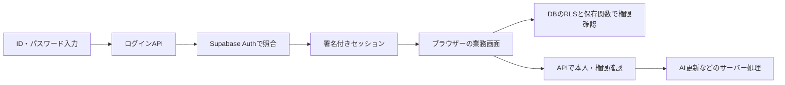

# 認証・権限移行（2026-10-30）

## requirements

ユーザーより、本人確認をSupabase Auth、業務データの制限をDBのRLS、管理権限を使うAPIの制限をAPI側で実施する仕様への変更を指示された。通常のログインはID・パスワードを入力する1段階を維持する。メール確認・MFA入力は通常ログインに追加しない。

既存のID・パスワードを継続する方針を確認済み。唯一6文字未満だったtestアカウントは、ユーザーが指定した新パスワードで移行した。文書・スクリプトにパスワードは記録しない。

## design



- 認証用の内部メール識別子をアカウントUUIDから生成する。利用者は従来のIDを入力し、メールアドレスは不要。
- `app_profiles`でログインID・有効状態・管理者区分を管理する。利用者による権限変更は禁止。本人は自分の安全な項目だけ読み取れる。
- パスワード照合はAuthのみ。ブラウザーへのユーザー・パスワード一覧取得、平文パスワードの保存、localStorageの真偽値を根拠にした権限判定を廃止する。
- Supabaseの署名付きセッションは公式クライアントで維持・更新する。ログイン状態は操作のたびに入力し直さない。
- APIは署名付きトークンを検証し、DBから現在の権限を確認する。RLSでは有効なプロフィールとAuthセッションの存在を確認する。
- 利用者が変更できるuser_metadata、リクエストのis_managerやx-managerを権限根拠にしない。

## 権限

| 操作 | 一般利用者 | 管理者 |
|---|---|---|
| 業務データ・予測結果の閲覧 | 可 | 可 |
| 日常の実績登録・工程移動・外注日程登録・出荷登録 | 可 | 可 |
| 受注取消・ロット削除復元・出荷取消 | 不可 | 可 |
| ユーザー管理・マスター変更・休日・AI設定 | 不可 | 可 |
| AI手動更新 | 不可 | 可 |

既存の受注編集など日常業務の更新は維持する。一般利用者に許可しない削除・取消は画面で無効化し、API/RPC/DBでも拒否する。権限の追加細分化は未実施。

AI自動更新は既存のCRON_SECRETで確認する。手動更新ボタンは維持し、管理者ログイン後は追加パスワード入力なしで操作可能。既存のvalidation_modeによる実行条件も維持する。AIへの送信項目を増やしていない。実行者別のAI履歴項目の追加は今回の対象外。

## implementation

- `lib/auth/server.ts`: APIの本人・権限検証。利用者ごとのDBクライアントをリクエスト内で作成し、他の利用者の認証情報と混在させない。
- `lib/auth/client.ts`: 自アプリのAPIにのみ認証トークンを送信する。
- `pages/api/auth/login.ts`: 従来IDでAuthにログイン。15分に15回までのID別試行制限。
- `pages/api/auth/me.ts`: 自分の現在の権限取得。
- `pages/api/auth/users.ts`: 管理者による利用者作成・編集・無効化・再有効化・パスワード再設定。パスワードを一覧へ返さない。
- `app/components/AuthProvider`: 未ログイン画面・管理者用画面を制御。旧ローカル保存値は削除する。
- 全既存業務APIに本人・権限検証を追加。各画面のAPI呼び出しにトークンを付ける。
- 出荷取消の追加パスワード入力と旧平文照合を廃止し、ログイン中の管理者権限で判定する。
- 旧ユーザー管理URLは新管理画面へ統合。未使用の旧パスワード取得用フック・コンポーネントを廃止。
- 最後の有効な管理者はDBで無効化・降格・削除を防ぐ。無効化・パスワード再設定時は対象者のセッションを失効させる。
- アカウントの物理削除は新管理画面から提供せず、無効化・復元で管理する。

## DB移行

適用済み:

- `20261030070357_secure_auth_and_permissions.sql`
- `20261030072432_pin_workflow_function_search_paths.sql`

変更前の権限・関数を`auth_permissions_before_20261030.json`、テーブル形状を`auth_table_schema_before_20261030.json`に退避した。業務データやパスワードを含まない。

28個の既存業務テーブルと新プロフィールにRLSを適用。既存ビューをsecurity_invokerに変更し、未ログインのテーブル・ビュー・関数利用を禁止した。保存RPCは直接呼び出されても有効な利用者かを確認し、管理操作では管理者を確認する。サービス権限は自動処理のため維持する。内部専用のbase/legacy関数は利用者から呼べない。

旧`public.user`は初回移行時に退避として保持され、アプリ利用者からの読取・書込権限は剥奪済み。ただし、旧平文パスワードの残存リスクは権限剥奪では解消しない。新ログイン・ユーザー管理はこのテーブルを使用しない。今回の修正は実データを削除せず、以下の廃棄手順を仕様化する。

## unit_test / integration_test（初回公開時の記録）

- `verify-auth-api.mjs`: 35件成功。トークン不正、未ログイン、管理者偽装、無効セッション、AI実行の拒否を検証。
- `verify-auth-db.mjs`: 65件成功。RLS、管理者保護、ログイン試行制限、無効化・セッション失効、権限付き工程移動・外注残数移動を検証。
- `rehearse-auth-schema.mjs`: 本番の28テーブル形状・41関数定義に対する両移行SQLのリハーサル成功。実データなし。
- `verify-progress-shipping-ui.mjs`: 108件成功。既存の進捗・出荷・複数ロット表示等を回帰確認。
- `verify-live-auth.mjs`: 46件成功。実際の3アカウントでログイン・API・RLS・サインアウト後拒否を確認。業務データは読取のみで、AIは実行していない。
- TypeScript・変更箇所のESLint・本番ビルド成功。
- ブラウザーでtestの1段階ログイン、一般メニュー、管理者画面への直接アクセス拒否を確認。

## system_review / 公開状況（初回公開時の記録）

ローカルアプリ・本番Supabase・Vercel公開アプリに反映済み。

2026-10-30、ユーザーより既存の未公開業務修正を含む最新版の本番公開とGitプッシュの承認を得た。実装コミット`e27e861458f2b984b6350899fb9e7d17bf21cb29`をmainへプッシュし、GitHubのVercelステータスsuccessを確認した。

公開先はVercelプロジェクト`kawane-app`、本番URL `https://kawane-app.vercel.app`。外注分割日程、確定ロット表示、履歴の並び順・ページ分割、在庫引当制限など、10月20日以降の業務修正も含む。

本番URLに対して`verify-live-auth.mjs`を実行し46件成功。3アカウントのIDログイン、本人の権限取得、業務ビューの読取、一般利用者の管理者API拒否、未ログインAPI拒否、旧パスワードテーブルの読取拒否、サインアウト後の拒否を確認した。AIは実行せず、業務データも変更していない。ブラウザーでも本番の1段階ログインと一般利用者メニューを確認した。

Vercel連携ツールの詳細取得は、チーム再認証承認後も403だったため、公開成否はGitHubのデプロイ成功ステータスと実際の本番URLで検証した。認証保護を無効化する等の回避は行っていない。

セキュリティ診断の残項目:

- 旧アカウント・旧履歴の2テーブルはアクセス全面拒否のためポリシーなし（意図した設定）。
- 25件の認証済み利用者向けSECURITY DEFINER RPCは、業務トランザクションのため維持。入口の権限検証を追加済み。
- 漏洩パスワード検知は未設定。今回はユーザー指定の既存パスワード継続方針を維持し、Authの強度設定は変更していない。

共用端末では使用後にサインアウトする。保持期間の独自制限やMFAは追加していない。


## 追加修正（2026-10-30、PRドラフト・承認後DB適用済み）

### requirements / 差し戻し理由

初回移行の一般利用者向けUPDATE権限では、RPCを通さず取消・削除フラグを変更できた。また、出荷の直接INSERTは`register_shipment`の数量・在庫検証を回避できた。ユーザーの指摘修正・仕様変更・テストの依頼に基づき、本仕様と実装を修正する。初回公開時の成功記録はこの追加修正の本番検証を意味しない。

### design / DB更新経路

- `shipments`の直接INSERT・UPDATE・DELETEは、一般利用者・管理者とも禁止する。一般利用者の出荷登録は`register_shipment`、管理者の取消は`cancel_shipment_and_restore_inventory`を利用する。取消フラグだけでなく数量・在庫・引当の整合性を同一トランザクションで保つ。
- `posts.delete`、`lots.deleted`は`authenticated`のUPDATE許可列から除外する（管理者も同じDBロールのため直接更新不可）。INSERTの制限ポリシーでも`true`を禁止し、INSERT/upsertによる取消状態の偽造を防ぐ。既存の`false`・`null`は許容する。取消・削除・復元は既存の権限検証付きRPCを利用する。
- ロットの削除日時・理由（`lots.deleted_at` / `deleted_reason`）も直接UPDATEから保護し、INSERT時はNULLのみ許可する。削除・復元RPCによる履歴変更は維持する。
- 初回認証移行で再公開された旧`ship_inventory_for_post(uuid,integer)`の実行権限を再び剥奪する。在庫だけを減らし出荷履歴を作らない旧経路は、一般利用者・管理者とも呼べない。
- `posts`の直接DELETEを禁止し、既存の受注取消RPCを使用する。`lots`の直接DELETEに関する既存の管理者専用ポリシーは変更しない。
- 既存の日常業務の編集は必要な項目に限定して維持する。画面の無効化だけを権限制御としない。DBへの直接要求、RPCへの直接要求、管理者・一般利用者の双方をテストする。
- 適用済み移行SQLを遡及変更せず、追加移行`20261030090416_enforce_workflow_write_boundaries.sql`で権限を修正する。準備段階では本番DB、Auth、公開アプリを変更しなかった。その後の公開・DB適用の承認と実施結果は末尾に記載する。

### 旧平文資格情報の保管・廃棄手順（承認待ち）

1. **責任者・期限の決定**: システム管理責任者が廃棄対象、実施責任者、実施日、バックアップ失効日を承認記録に残す。具体的な担当者・期日は未確定であり、無期限保管を既定にしない。決定前に自動削除しない。
2. **移行照合**: パスワードを取得・表示せず、旧IDと`app_profiles.id`、`auth.users.id`の対応、有効状態、管理者の存在、無効アカウントの扱いを件数・識別子で確認する。ID変更や未移行アカウントは解決してから進める。
3. **依存排除**: アプリ、検証スクリプト、運用ジョブ、ビュー、関数、外部連携を調べ、旧`pass`列の利用がないことを確認する。`prepare-auth-users.mjs`は初回移行専用で再実行しない。移行済み利用者の検証には専用テスト資格情報を用いる。旧パスワードをCSV・ログ・追加バックアップに複製しない。
4. **承認後のみ廃棄**: 本番作業の明示承認を受けた後、DB所有者が依存関係と制約を事前確認した専用トランザクションで旧`public.user.pass`列を廃棄する。`CASCADE`で未確認依存を削除しない。アカウントIDなど必要な履歴は別途保持可否を判断し、Authや`app_profiles`は削除しない。今回の追加権限移行には廃棄SQLを含めない。
5. **バックアップ管理**: 既存バックアップ・スナップショット・PITR・エクスポートにも旧パスワードが残り得る。アクセスを限定し、保存期間・削除可能日を管理責任者が確認する。表の列削除だけで全コピーを消したと判断しない。災害復旧時もアプリ再公開前に資格情報廃棄と最新権限移行を再適用する。
6. **認証継続と漏洩対応**: 平文廃棄はAuthのハッシュ済みパスワードを変えない。実行後に承認済み専用アカウントでログインと業務読取を確認する。漏洩が疑われる場合は別途、全対象者のパスワード再設定・セッション失効と他サービスでの使い回し対策を検討・承認する。バックアップ失効だけでは既に知られたパスワードは無効にならない。
7. **監査記録**: 廃棄対象、承認、実施時刻、列不存在・依存ゼロの確認、バックアップ残存期限を記録する。資格情報の値は記録しない。失敗時はトランザクションをロールバックして原因を調査し、旧平文認証を復活させない。

### 認証検証スクリプトの実行条件

`verify-live-auth.mjs`は旧ユーザーの一覧・平文パスワードを読み取らず、サービスロールキーも使用しない。以下を、承認された検証先と専用アカウントについて安全な環境変数として指定する。秘密値をコマンド履歴・文書・Gitへ保存しない。

- `KAWANE_ALLOW_LIVE_AUTH_TEST=yes`: **実行承認を取得してから**指定する明示オプトイン。
- `KAWANE_VERIFY_ORIGIN`: 検証対象アプリのオリジン。既定値はない。
- `NEXT_PUBLIC_SUPABASE_URL` / `NEXT_PUBLIC_SUPABASE_ANON_KEY`: 上記アプリと同じ承認済み環境の公開接続情報。
- `KAWANE_VERIFY_WORKER_ID` / `KAWANE_VERIFY_WORKER_PASSWORD`: 専用の一般利用者。
- `KAWANE_VERIFY_ADMIN_ID` / `KAWANE_VERIFY_ADMIN_PASSWORD`: 別の専用管理者。

実行: `node scripts/verify-live-auth.mjs`。必要項目・オプトインの不足時は通信前に終了する。外部への平文HTTP、資格情報入りURL、パス付きURLは拒否する。アプリへのHTTPリダイレクトを追跡しない。資格情報の値・トークンは出力しない。

この検証は業務データを読取のみとするが、**ログイン試行数とAuthセッションを作成・失効するため完全な読取専用ではない**。本番での実行には別途承認が必要。専用アカウントは事前に用意し、このスクリプトは作成しない。失敗時もサインアウトを試みる。セッション終了に失敗した場合は管理者が専用アカウントの残存セッションを失効する。今回は本番ログイン検証を実行していない。

### unit_test / integration_test / system_review（適用前ローカル検証）

基準コミット: `1f931ca87899424d751e75927abecae2da55e6c6`。クラウド内のローカルコピーと合成データだけを使用した。

| 検証 | 結果 | 範囲 |
|---|---|---|
| `verify-workflow-permissions.mjs` | 147件成功 | 既存出荷55件＋今回の権限92件。直接INSERT/UPDATE/DELETE/upsert/ビュー経由の拒否、管理者・一般利用者、実際のロット削除復元・出荷登録取消RPC、在庫・引当復元、二重取消、旧RPC拒否、通常編集、無効・失効セッション、列権限の残存除去、移行再適用 |
| `verify-live-auth-config.mjs` | 20件成功 | 通信なし。オプトイン・必須値・URL・専用アカウント区分を検証 |
| `verify-auth-api.mjs` | 35件成功 | オフラインAPI認証・権限 |
| `verify-auth-db.mjs` | 65件成功 | 既存の認証・RLS・工程移動 |
| `verify-progress-shipping-ui.mjs` | 108件成功 | オフラインReact描画・API回帰。既存テストモックの条件付きHook呼出を修正して全体Lintも正常化 |
| 出荷・引当・外注・日付の既存DBテスト | 全件成功 | `verify-safe-shipping` 55、`verify-allocation-progress` 104、`verify-outsource-transfer` 25、`verify-outsource-remainders` 50、`verify-transfer-dates` 11 |
| `verify-ai-prediction.mjs` | 28件成功 | オフラインのみ。Gemini実行なし |
| TypeScript / 全体ESLint / `git diff --check` | 成功 | 最終変更に対して実施 |
| `npm run build` | 成功 | localhostのダミーSupabase URL/公開キーでビルド。実環境への接続なし |
| 独立コードレビュー | 対象範囲の阻害問題なし | 旧出荷RPC迂回を検出・修正後、147件を独立再実行 |

DBテストはPGlite 0.3.14の隔離PostgreSQLを使用する。新テストは既存出荷テストを含むため件数は重複し、独立ケース総数とはみなさない。実際の出荷・ロットRPC定義を読み込み、代替スタブで成功を作らない。全本番スキーマのリハーサル用JSONはGit管理対象外で今回のコピーに存在しないため、`rehearse-auth-schema.mjs`は未実行。

再実行例（依存はリポジトリ外に固定バージョンで導入）:

```sh
npm ci
npm install --prefix /tmp/kawane-test-tools --ignore-scripts --save-exact @electric-sql/pglite@0.3.14
node scripts/verify-workflow-permissions.mjs /tmp/kawane-test-tools/node_modules/@electric-sql/pglite/dist/index.js
node scripts/verify-live-auth-config.mjs
node scripts/verify-auth-api.mjs
node scripts/verify-auth-db.mjs /tmp/kawane-test-tools/node_modules/@electric-sql/pglite/dist/index.js
node scripts/verify-progress-shipping-ui.mjs
npx tsc --noEmit
npm run lint
NEXT_TELEMETRY_DISABLED=1 NEXT_PUBLIC_SUPABASE_URL=http://127.0.0.1:54321 NEXT_PUBLIC_SUPABASE_ANON_KEY=local-test-placeholder npm run build
```

**未実施・制限**: Chromiumの起動を試みたが、クラウドのsocket制限（`Operation not permitted`）で起動前に終了したため、実ブラウザーE2Eは未検証。別コマンドからローカルサーバーへのHTTP確認も接続不可で成功とは扱わない。オフラインReact描画テストはブラウザーE2Eの代替証明ではない。本番・ローカルアプリへの実ログイン、旧資格情報の削除、公開、プッシュ、本番移行適用は行っていない。

**公開手順**: 変更パッチを上記基準コミットへ適用・レビューし、承認後に修正ブランチを公開する。承認された検証環境で全スキーマへの追加移行とブラウザー動作を確認してから、別途本番適用の承認を受ける。適用済み移行を編集・再実行せず、新しい移行だけを追加する。移行後は権限・RPC・在庫整合性を確認し、承認済み専用アカウントだけで認証確認する。旧平文資格情報の廃棄は別の承認・運用手順で行う。

### 承認後の本番DB適用・限定検証（2026-10-30 09:37–09:40 UTC）

ユーザーは対象が本番環境であること、データはテストデータであることを明示したうえで、修正SQL適用およびテスト用レコードの作成・更新・取消を承認した。一括削除・旧パスワード削除・アカウント作成・権限拡張・mainマージは対象外。

**接続先確認**: 既存仕様書の本番URL `https://kawane-app.vercel.app` が配信する公開JavaScriptからSupabase URL `https://jzltezetvfqdiyzpcmmc.supabase.co` を読み取り、接続ツールのプロジェクトID・DBホストと照合した。プロジェクト名や唯一のACTIVE状態だけで選択していない。既存移行・対象列・制約・RLS・RPC定義を読み取り、準備済みSQLとの互換性を確認後に適用した。

**適用結果**: `enforce_workflow_write_boundaries` を1回適用し成功。Supabaseツールが記録した実適用バージョンは `20261030093717`。リポジトリの `20261030090416_enforce_workflow_write_boundaries.sql` と同じSQLである。タイムスタンプが異なるため、今後CLIで移行管理を行う際はこの対応関係を確認し、未適用と誤認して再実行しない。旧移行の記録にもツール生成時刻とファイル時刻の差がある。移行履歴の書換えは今回行っていない。

**適用直後の権限確認**: 受注取消・ロット削除／削除日時／理由の直接UPDATE、受注DELETE、出荷INSERT/UPDATE/DELETE、旧出荷RPC実行がすべて不可。通常の受注備考編集と正規出荷登録・取消RPCの実行権限は維持。

**実DB検証52件成功**: `supabase/checks/verify_workflow_write_boundaries_rollback.sql` を実行した。既存の有効な一般／管理者プロフィールと既存セッションを参照し、SQLトランザクション内で `authenticated` / `anon` とJWT claimsを切り替えて検証する。これはSQLロール模擬であり、署名付きHTTPトークンの検証やブラウザーログインの成功を意味しない。Authユーザー・セッションは新規作成・変更していない。

- 一般・管理者双方の直接書込、取消状態／削除理由を偽造するINSERT、旧出荷RPCを拒否。
- 通常編集、一般利用者のロット作成・正規出荷、管理者の受注作成・受注取消・ロット削除復元を確認。
- 数量不正・注残超過を拒否し、30個出荷で在庫120→90、引当消費20を確認。
- 管理者取消で在庫120・引当在庫20・引当出荷数0へ復元。二重取消で在庫が増えないことを確認。
- 一般利用者の管理RPCと存在しないセッション・未認証の操作を拒否。
- 専用識別子 `KAWANE-AUTH-VERIFY-20261030-0938-...` の行のみ作成し、最終 `ROLLBACK`。別クエリで受注・ロット・在庫・引当・出荷のテスト行残存が各0件であることを確認。既存業務行の削除・更新は行っていない。

**セキュリティ診断**: 利用者向けSECURITY DEFINER警告は25→24件（旧出荷RPCが対象外へ）。残る24件は権限チェック付き業務RPC。旧2テーブルの「RLS有効・ポリシーなし」は全面拒否の意図した状態。漏洩パスワード検知未設定の既存警告は残る。この設定や旧平文資格情報は変更していない。

**未完了**: GitHub PR #1はドラフト・未マージ。SHA `36eebdbcb3b60ae150379d2118610b62b5c6fde9` のVercel自動チェックは新しい実行 `B2WdJWEVCkmLGpCsqYKxLxWjG9rv` でもfailure（09:40 UTC確認）。ユーザーが共有した再実行ログ（18:34:50–18:35:45 JST）でも、コンパイル・TypeScript成功後に同じ `supabaseUrl is required` が発生している。`NEXT_PUBLIC_SUPABASE_URL` が当該Previewビルドに非空値で渡っていないことを再確認した。Vercel APIの403を回避せず、設定変更・手動再デプロイは実行していない。Preview環境設定の確認と新ログが必要。ブラウザーUI・実ログインの検証は未実施。

【次のAIへの引き継ぎ事項】
DB移行・52件のロール模擬検証・残存0件確認は完了。適用済みSQLを再実行しない。新しいVercel失敗ログを確認し、Previewビルド後に承認された利用者のブラウザー動作を検証する。mainマージ・旧平文資格情報廃棄は別承認。旧平文資格情報の廃棄担当者、実施期限、バックアップ失効日は未確定。
