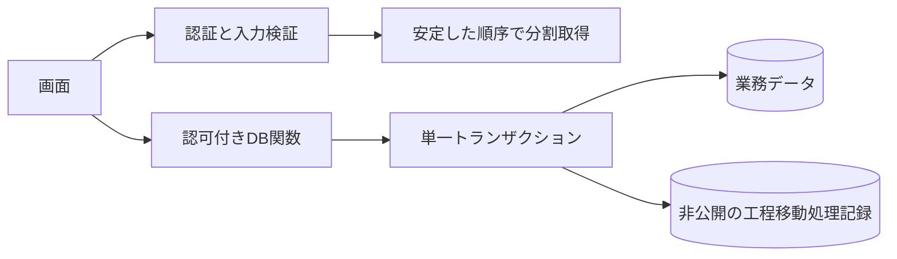

# 本番稼働前試験報告書への対応（2026-11-12）

対象：`川根アプリ_本番稼働前システム試験報告書_7f811b06 (1).docx`。開始時点のmainは`7f811b06`。

## 要件・設計（requirements / design）

報告書のR1～R11、C06/C07、O1を修正対象とする。O2は旧資格情報の新たな読取を止め、メタデータ調査と廃棄手順を整える。旧資格情報・バックアップの物理削除は別途対象と手順の承認後に実施する。

休日の年単位置換と3部署の一括保存は、それぞれ1つのDB関数内で行う。工程移動は処理キー単位にロックし、入力と戻り値を非公開テーブルに記録する。認可は既存の`assert_access`を維持する。既存の業務データを一括修正・削除する処理は追加しない。



## 実装（implementation）

| 指摘 | 変更と結果 |
| --- | --- |
| R1 | カレンダーのDELETE→INSERTを画面から分離実行せず、`replace_company_calendar_year`で原子的に置換。件数・実在日・年・重複・型を保存前に検査。失敗後も選択ファイルを保持し再試行可能。 |
| R2 | ロットの最新ポインタだけでなく、当該ロットの前工程・対象工程の正の実績を検査。作業日より後、または日付不明の実績がある場合は移動を拒否。数量修正による減少を含め全残数を消費する既存仕様に合わせ、部分数量でも同条件を適用する。日付別数量を選択消費するFIFO機能ではない。 |
| R3 | 本番適用済みの直接書込制限をmainの新規マイグレーションへ収録。受注削除列・ロット削除列・出荷直接操作を拒否し、専用RPCへ集約。本番の4権限は読取確認でもfalse。PR #1はマージしない。 |
| R4 | 部署別保存から表示用の開始予定日を除外。受注から継承表示した日付で、生産予定自身の独立値を上書きしない。 |
| R5 | 全部署の完了予定日を`save_daily_department_dates`へ1回送信。2部署目で失敗しても1部署目の更新を戻す。既存開始予定日・実績数量を維持し、新規行の予定数量は未出荷残数を使用。 |
| C06/C07 | 処理キーの排他と入力照合を追加。同じ入力の同時再送は同じ成功結果を返す。異なるロット・工程・数量・日付・理由は拒否。既存履歴だけの旧キーも照合。画面も通信失敗後の同じ入力には同じキーを使う。 |
| R6 | 未使用のfirebase/jspdf/jspdf-autotableを削除。SheetJSを公式配布0.20.3へ変更。LINE SDKを直接依存として10.8.0に固定。更新可能な依存を更新し、開発依存のminimatchも限定overrideで修正。lockfileを更新。全依存の監査0件。 |
| R7 | テスト用Hookの条件付き呼出しと未使用変数を修正。Lint規則の無効化はしない。 |
| R8 | 日次生産・生産予定・製造実績APIと関連する出荷・工程の読取を、IDを含む安定した順序で全件ページング。生産予定・実績画面の直接読取も対応。 |
| R9 | 出荷日の納期は実在するYYYY-MM-DD、前倒し日数は0～3650の整数に限定。不正入力は400。UTCで計算して日付の地域差を避ける。 |
| R10 | 認証サービスの500/429/通信障害は503として案内。無効トークンの400/401/403は401。障害を期限切れと誤表示しない。 |
| R11 | 実績・ロット・工程・生産予定のPOST/PUT/DELETEで必須項目、ID、型、日付、数量、更新項目を検査。日次生産の登録も共通化。DBの権限・外部キー・型等のエラーを適切な4xxへ分類。 |
| O1 | LINEクライアントを認証・権限確認後に生成。未設定は503、送信失敗は502。入力を検査し、実送信内容や秘密をエラーへ含めない。 |
| O2 | 旧パスワードを読む移行用準備スクリプトを廃止。ライブ検証も明示指定のテスト資格情報だけを使用。DB内の値は取得・複製していない。 |

追加SQL：

- `20261112000417_preproduction_integrity_fixes.sql`：非公開再送記録テーブル、カレンダー置換・部署日程一括保存の2関数、工程移動関数の更新。
- `20261112000424_sync_workflow_write_boundaries.sql`：本番の既存制限とリポジトリの再構築結果を一致させる冪等な権限修正。本番既適用分はremote `20261030093717`。

## 検証（unit_test / integration_test）

本番データで製造・工程移動・出荷・削除の試験はしない。PostgreSQL 18.6の別クラスタを127.0.0.1:55491に起動し、毎回別の使い捨てDBを作成・削除する。既存PostgreSQLサービスは操作しない。

| テスト | 検証内容 |
| --- | --- |
| `verify-preproduction-db.mjs` | Critical/High：カレンダー挿入失敗の巻戻し、重複・不正日の拒否、3部署途中失敗の巻戻し、開始予定日の保持、逆順製造日の移動拒否、工程移動途中失敗後の再試行。Medium：5接続すべてのロック待ちを確認して解除し、通常移動・最終在庫化の各再送が一致、異なる入力の競合拒否、旧キー互換、直接DML拒否。48確認。 |
| `verify-preproduction-api.mjs` | High：999/1000/1001/1500/5000件と関連する出荷・最終工程を検証。Medium：必須入力、型、DBエラー分類、実在日、Auth障害と復帰、LINE未設定で認証先行。188確認。 |
| `verify-calendar-import.mjs` | High：本物のXLSX/XLS/CSVをSheetJSで解析、原子的RPCの呼出し、失敗時ファイル保持と再試行。35確認。 |
| 既存回帰群 | AI、認証・権限、外注分割・移動、製品別ロット、在庫・引当、出荷・打ち切り・復元、履歴保管、受注登録、日程編集を確認。認証DB試験は新しい直接操作制限を適用して69確認。 |

実行例：

```powershell
node scripts/verify-preproduction-db.mjs "$env:TEMP/kawane-preprod-pg-20261112/node_modules/pg/lib/index.js"
node scripts/verify-preproduction-api.mjs
node scripts/verify-calendar-import.mjs
npx tsc --noEmit
npm run lint
npm run build
npm audit
```

DB試験の前提は、合成データ専用クラスタとpgクライアント。DB名はスクリプトが作成し、終了時に破棄する。認証サービスの実セッションを使う試験とは区別する。旧データリセット専用`verify-test-reset-plan.mjs`は、当時の退避ファイルを必要とする運用手順検証のため今回の回帰群には含めない。

## O2：旧資格情報の残課題と廃棄手順

2026-11-12の本番メタデータ調査では、`public.user.pass`列は存在する。anon/authenticatedのテーブルSELECTはfalse、service_roleのpass列SELECTはtrue。公開・非公開アプリスキーマの関数定義とビュー定義を文字列検索した範囲で、旧user/pass参照は0件。動的SQL等を含む全経路の安全性を証明する調査ではない。パスワード値の有無や平文保存の実態は調べていない。

1. 責任者が利用中アカウントとSupabase Authの移行完了を、ID・有効区分・権限・実ログインで照合する。旧パスワード値は取り出さない。
2. 通常処理・運用スクリプト・外部連携に旧列の依存がないことを確認する。
3. 管理者がバックアップ、スナップショット、PITR、過去エクスポートの所在・保持期限・アクセス権・廃棄可能日を一覧化する。プロジェクト外の社内保管物はこのコード検証では確認できない。
4. 廃棄対象（旧pass列と列を含む退避物）、担当者、実施日、バックアップ失効日を具体化して承認を得る。新たに秘密を含む退避ファイルは作らない。
5. 承認後に旧pass列を除去し、Authログイン・権限・業務画面を再確認する。バックアップの残存期間はアクセスを制限し、期限到来時に廃棄記録を残す。

この作業では列・行・既存バックアップを削除しない。列が残ることを現在の漏洩の証拠とも扱わない。

## 最終品質確認（system_review）と反映状態

修正範囲の型検査・Lint（警告も0）・本番ビルドが成功。全依存、本番依存のみのいずれも`npm audit`は0件。合成DBおよび画面イベントを含む29スイートすべてが成功した。詳細の集計は`preproduction_verification_20261112.json`を参照。

本番反映前のSupabase Security Advisorは従来どおり、RLS有効・ポリシーなし3件、authenticated向けSECURITY DEFINER 32件、漏洩済みパスワード保護無効1件。専用RPCは内部で認可する設計のため一律に実行権限を外さない。新規2関数にも認可・固定search_path・anon拒否を付けている。参考：[関数実行権限の指摘](https://supabase.com/docs/guides/database/database-linter?lint=0029_authenticated_security_definer_function_executable)、[Authのパスワード保護](https://supabase.com/docs/guides/auth/password-security#password-strength-and-leaked-password-protection)。Auth設定変更は今回行わない。

反映状態：自動承認審査の確認を受け、ユーザーがSQL適用・Gitプッシュ・本番公開・確認まで明示承認。2026-11-12に次の2件を本番へ適用済み。

- local `20261112000417` → remote `20261112072912_preproduction_integrity_fixes`
- local `20261112000424` → remote `20261112072922_sync_workflow_write_boundaries`

適用後の読取確認：新規2関数はanon実行不可・authenticated実行可、再送記録はRLS有効・authenticated読取不可。工程移動のキー排他と日付検査が存在し、受注削除列・ロット削除列・出荷取消列・出荷INSERTの直接権限はすべてfalse。Security AdvisorはRLSポリシーなし3件・漏洩済みパスワード保護無効1件が従来どおり。認可付きの新規2関数によりauthenticated向けSECURITY DEFINERは32件から34件になった。業務データを使う製造・移動・出荷の試験、旧資格情報の削除は行っていない。

Gitプッシュと公開結果は次の反映記録に追記する。

未確定：実Supabase Auth→実ブラウザー→API→隔離DBを接続した5利用者の全工程E2E、実際のLINE送信、バックアップ失効日の確認は未実施。この結果だけで本番運用開始を全面保証しない。

【次のAIへの引き継ぎ事項】
SQL適用済み。Gitプッシュ・公開を確認し、旧資格情報の廃棄と実認証ブラウザーE2Eを残課題として継続する。
